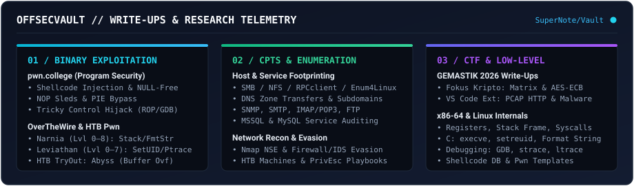
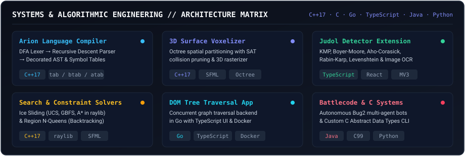

 

---

## Offensive Security & Write-Ups — [`OffsecVault`](https://github.com/Nusss0/OffsecVault)

  

 

| Category | Platform / Track | Highlighted Write-Ups & Technical Scope |
| :--- | :--- | :--- |
| **Binary Exploitation (Pwn)** | **[pwn.college](https://github.com/Nusss0/OffsecVault/tree/main/SuperNote/WriteUps/Challenge/PwnCollege/Intro%20to%20Cybersecurity)** | 9 write-ups covering custom x86-64 shellcode injection, [NULL-Free Shellcode](https://github.com/Nusss0/OffsecVault/blob/main/SuperNote/WriteUps/Challenge/PwnCollege/Intro%20to%20Cybersecurity/NULL-Free%20Shellcode.md), [NOP Sleds](https://github.com/Nusss0/OffsecVault/blob/main/SuperNote/WriteUps/Challenge/PwnCollege/Intro%20to%20Cybersecurity/NOP%20Sled.md), [PIE Bypass](https://github.com/Nusss0/OffsecVault/blob/main/SuperNote/WriteUps/Challenge/PwnCollege/Intro%20to%20Cybersecurity/PIEs.md), and [Tricky Control Hijack](https://github.com/Nusss0/OffsecVault/blob/main/SuperNote/WriteUps/Challenge/PwnCollege/Intro%20to%20Cybersecurity/Tricky%20Control%20Hijack.md) via GDB disassembly. |
| **Linux Exploitation & PrivEsc** | **[OverTheWire](https://github.com/Nusss0/OffsecVault/tree/main/SuperNote/WriteUps/Challenge/OverTheWire)** | Complete 18-level walkthroughs for **[Narnia (0–8)](https://github.com/Nusss0/OffsecVault/tree/main/SuperNote/WriteUps/Challenge/OverTheWire/Narnia)** and **[Leviathan (0–7)](https://github.com/Nusss0/OffsecVault/tree/main/SuperNote/WriteUps/Challenge/OverTheWire/Leviathan)**: stack buffer overflows, format string attacks, environment variable hijacking, and SetUID/`ltrace` analysis. |
| **CTF Competitions** | **[GEMASTIK 2026](https://github.com/Nusss0/OffsecVault/tree/main/SuperNote/WriteUps/Challenge/Gemastik)** & **[HTB CTF](https://github.com/Nusss0/OffsecVault/tree/main/SuperNote/WriteUps/Challenge/HTB%20CTF/TryOut)** | **[Fokus Kripto](https://github.com/Nusss0/OffsecVault/blob/main/SuperNote/WriteUps/Challenge/Gemastik/Fokus%20Kripto.md)** (AES-ECB key recovery from matrix exponentiation), **[VS Code Extension](https://github.com/Nusss0/OffsecVault/blob/main/SuperNote/WriteUps/Challenge/Gemastik/VS%20Code%20Extension.md)** (PCAP HTTP object extraction via `tshark` & payload deobfuscation), and **[HTB Abyss](https://github.com/Nusss0/OffsecVault/blob/main/SuperNote/WriteUps/Challenge/HTB%20CTF/TryOut/Abyss.md)** (non-null-terminated `read()` buffer overflow). |
| **Network & Service Enumeration** | **[HTB CPTS Notes](https://github.com/Nusss0/OffsecVault/tree/main/SuperNote/CPTS)** | Structured playbooks on **[Footprinting](https://github.com/Nusss0/OffsecVault/tree/main/SuperNote/CPTS/Footprinting)** (`SMB`, `DNS`, `NFS`, `SNMP`, `SMTP`, `IMAP/POP3`, `MSSQL`, `MySQL`), **[Nmap & IDS/IPS Evasion](https://github.com/Nusss0/OffsecVault/tree/main/SuperNote/CPTS/Network%20Enumeration%20with%20Nmap)**, and **[Pentesting Process](https://github.com/Nusss0/OffsecVault/tree/main/SuperNote/CPTS/PenTestingProcess)**. |
| **Low-Level Internals** | **[Material & Reference](https://github.com/Nusss0/OffsecVault/tree/main/SuperNote/Material)** | **[x86-64 Assembly](https://github.com/Nusss0/OffsecVault/tree/main/SuperNote/Material/Language/Assembly)** (registers, stack operations, control flow), **[C Internals](https://github.com/Nusss0/OffsecVault/tree/main/SuperNote/Material/Language/C)** (`execve`, `setreuid`, `snprintf`), **[Linux Syscalls](https://github.com/Nusss0/OffsecVault/tree/main/SuperNote/Material/Linux)**, and **[Shellcode Database](https://github.com/Nusss0/OffsecVault/tree/main/SuperNote/Material/Database)**. |

---

## Systems & Algorithmic Engineering

  

 

| Project | Stack | Architecture & Technical Details |
| :--- | :--- | :--- |
| **[Arion Language Compiler](https://github.com/Nusss0/Tubes-IF2224-ArionCompiler)** | `C++17` | Three-stage compiler implementing a DFA-based lexical analyzer, recursive descent parser, and AST semantic analyzer with symbol table management (`tab`, `btab`, `atab`). |
| **[3D Surface Mesh Voxelizer](https://github.com/Nusss0/Tucil_IF2211_3D-Object-Surface-Voxelizer)** | `C++17` `SFML` | High-performance 3D mesh voxelizer built with Octree spatial partitioning, Separating Axis Theorem (SAT) collision pruning, and a custom SFML 3D software rasterizer. |
| **[Judol Detector Web Extension](https://github.com/Nusss0/Tubes_IF2211_Judol-Detector-Web-Extension)** | `TypeScript` `React` `MV3` | Chromium Manifest V3 extension detecting online gambling content via KMP, Boyer-Moore, Aho-Corasick, Rabin-Karp, weighted Levenshtein distance, and OCR image scanning. |
| **[Ice Sliding Puzzle Solver](https://github.com/Nusss0/Tucil_IF2211_Ice-Sliding-Puzzle-Solver)** | `C++17` `raylib` | Optimal pathfinding solver implementing UCS, GBFS, and A* over multi-checkpoint state spaces with a step-by-step raylib GUI visualizer. |
| **[DOM Tree Traversal App](https://github.com/Nusss0/Tubes_IF2211_DOM-Tree-Traversal)** | `Go` `TypeScript` `Docker` | Full-stack traversal solver featuring a concurrent Go backend API and TypeScript frontend, containerized with Docker Compose. |
| **[Region N-Queens Solver](https://github.com/Nusss0/Tucil_IF2211_N-Queens-Solver)** | `C++17` `SFML` | Color-region N-Queens solver using brute force and pruned backtracking with both a CLI and live-animated SFML GUI. |
| **[Battlecode 2025 Autonomous Bot](https://github.com/Nusss0/Tubes_IF2211_Battle-Code-2025)** | `Java` | Multi-agent strategy bots utilizing Bug2 navigation, inter-unit message protocols, and greedy resource/territory expansion heuristics. |
| **[YAREU Marketplace & Donation](https://github.com/Nusss0/Tubes_IF2150_Marketplace-Donation-System)** | `Python` `Flet` `PostgreSQL` | Full-featured MVC desktop/web platform supporting marketplace transactions, monetary/item donations, and trade-ins. |
| **[Nimons Hospital CLI System](https://github.com/Nusss0/Tubes_IF1210_Rumah-Sakit-Nimons)** | `C` | Procedural hospital management system engineered from scratch using custom Abstract Data Types (ADTs). |

<strong>Additional Repositories & Coursework Projects</strong>

 

- **[Matrix & Linear System Calculator](https://github.com/Nusss0/Tubes_IF2123_Matrix-Calculator)** (`Java`) — Linear algebra toolkit for solving systems of linear equations, determinants, regressions, and image interpolation.
- **[Elden Ring Armor Optimizer](https://github.com/Nusss0/EldenRing-Armor-Optimizer)** (`Python`) — Combinatorial optimization script for maximizing armor defense under equip-load budget constraints.
- **[NimonsPoli](https://github.com/Nusss0/Tubes_IF2010_NimonsPoli)** (`C` / `Java`) — Object-oriented board game engine implementation.
- **[Pokemons Logic Engine](https://github.com/Nusss0/Tubes_IF1221_Pokemons)** (`Prolog`) — Declarative rule-based game logic and query system in Prolog.
- **[Exploratory Data & Regression Analysis](https://github.com/Nusss0/Tubes_WI2002_Exploratory-Data-Analysis-and-Regression-Analysis)** (`Python`) — Statistical modeling and regression analysis pipeline.
- **[dotfiles](https://github.com/Nusss0/dotfiles)** (`Shell`) — Automated Linux bootstrap and configuration scripts (`i3`, `tmux`, `vim`).

---

## Technical Stack

---

## GitHub Telemetry

  
  

